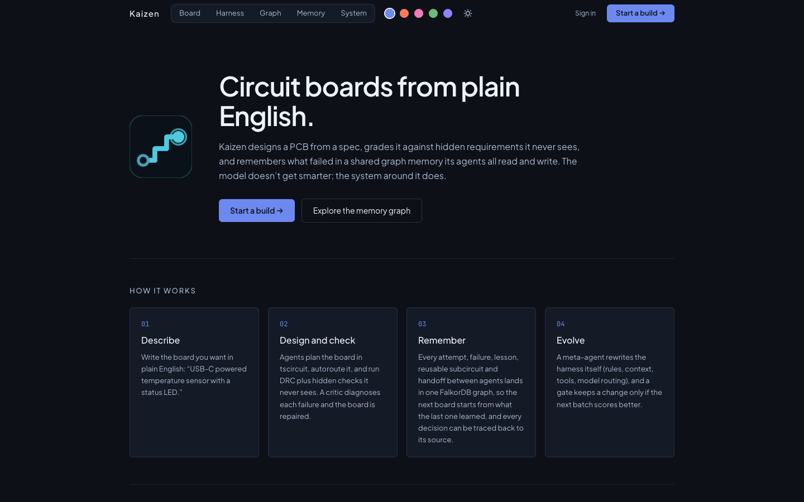
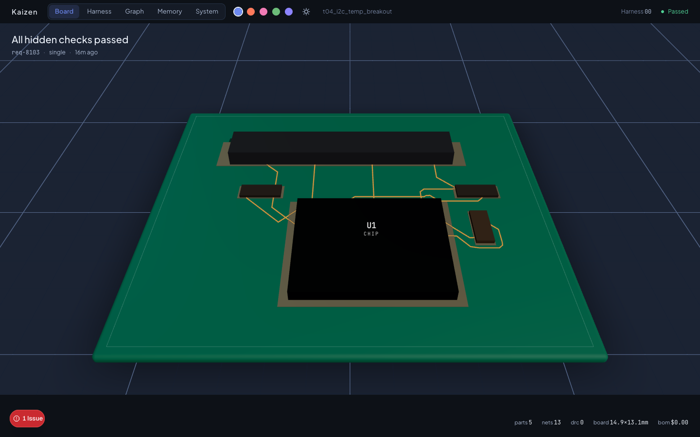
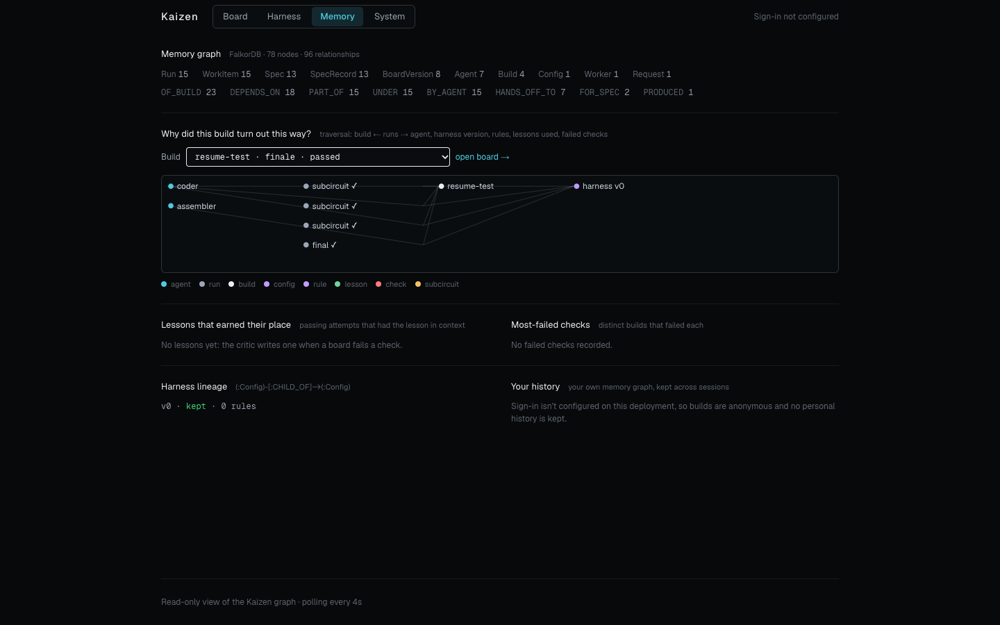
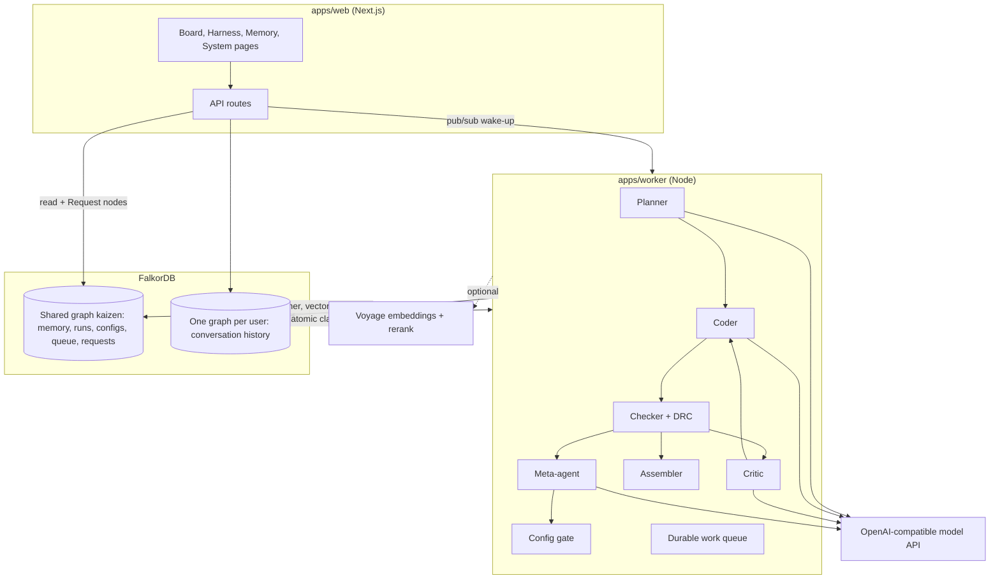
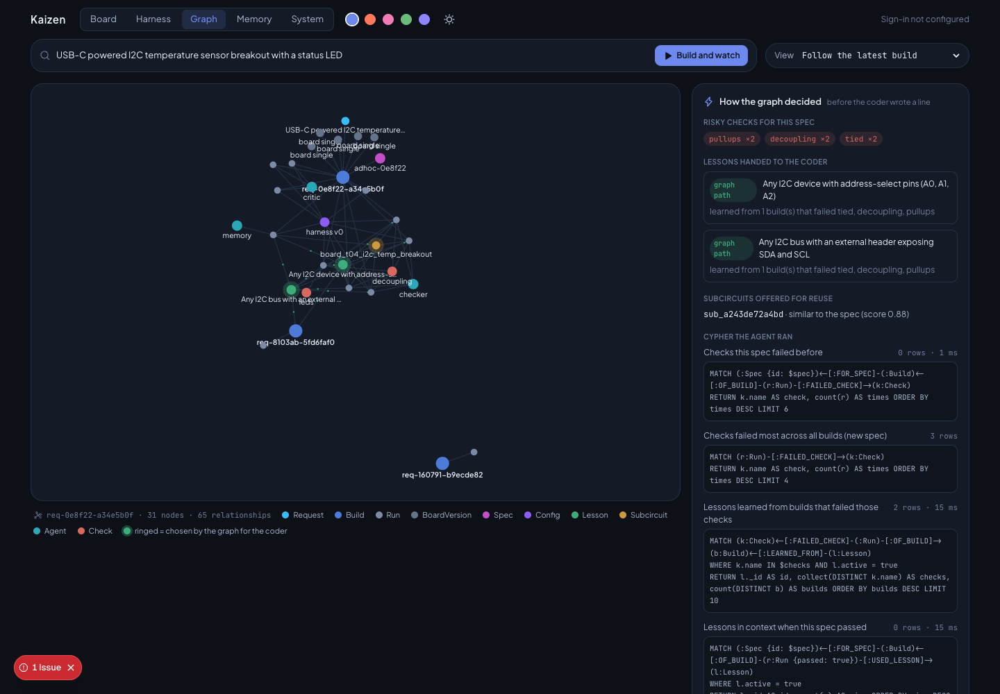
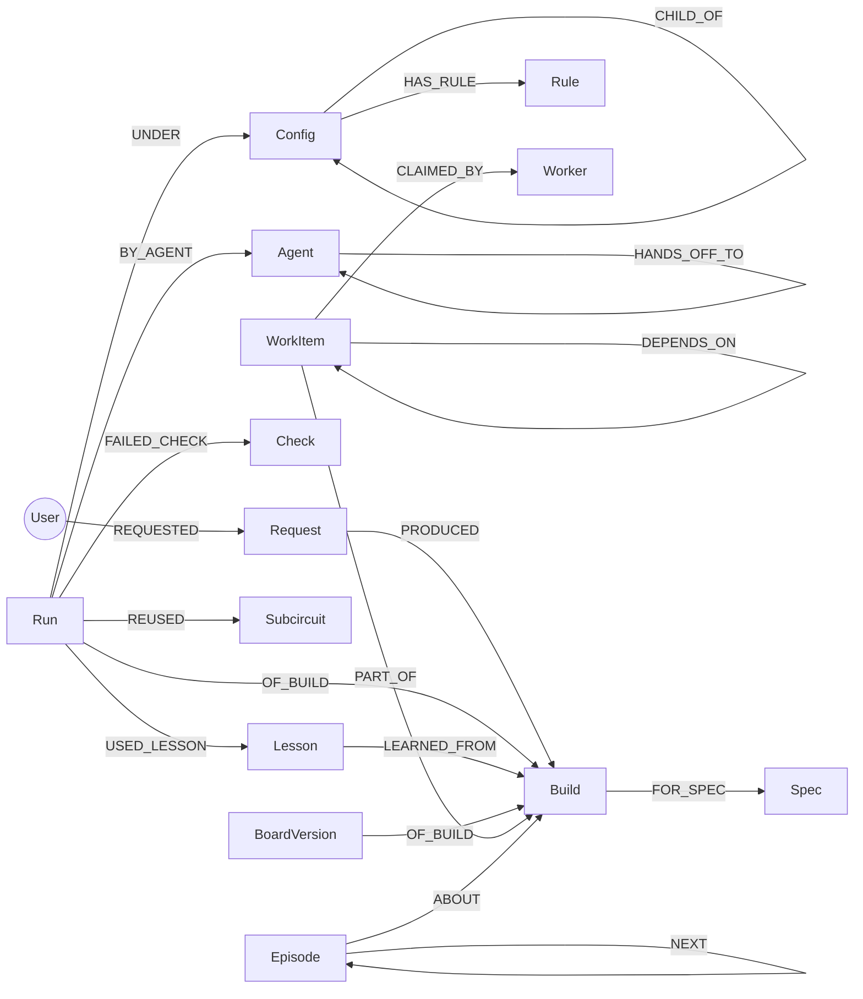

# Kaizen

**Circuit boards from plain English, designed by AI agents that share one graph memory.**

Kaizen turns a sentence like *"USB-C powered temperature sensor with a status LED"* into a routed, manufacturable printed circuit board (Gerbers, BOM, KiCad project, 3D model). A team of agents plans, writes, checks and repairs the board. Everything they do (every attempt, failure, lesson, reusable subcircuit, config change and handoff) lands in one [FalkorDB](https://www.falkordb.com) graph, and **the graph decides what the agents are told**: before each build, Cypher traversals pick the lessons and blocks with real outcomes behind them. Every decision can be traced back to the path that caused it.



**Demo video:** _link added on submission_ · **Blog:** [We let a graph decide what our AI agents remember](https://tanmaysahu3.medium.com/we-let-a-graph-decide-what-our-ai-agents-remember-1b7dd92b29a0) · Built for [Graph Hacks: Context for AI Agents](https://www.wemakedevs.org/hackathons/falkordb), Track 02 (Agent Memory and Coordination).

**FalkorDB is the only database.** It holds the agents' memory (episodic, semantic, procedural), their shared work queue, the request inbox, user accounts and one private graph per user. Take FalkorDB away and the agents have nothing to read, nothing to claim and nothing to remember.

### How Kaizen uses FalkorDB

| FalkorDB feature | What Kaizen does with it |
|---|---|
| Cypher traversals | Before every build, five queries decide which lessons, warnings and subcircuits the coder gets (see [How the agent queries it](#how-the-agent-queries-it)) |
| Vector indexes on nodes | `Lesson`, `Subcircuit` and failure nodes carry embeddings in the same graph, so similarity search and traversal run against one store |
| Atomic queries | A worker claims the next ready `WorkItem` or `Request` in one query: no locks, no double claims (tested with 12 workers racing for 6 steps) |
| Pub/sub | The web app writes a `Request` node and publishes its id; the worker wakes immediately instead of polling |
| Multigraph | One shared graph `kaizen` for agent memory, plus one isolated graph `kaizen_user_<hash>` per user for their history, in a single instance |
| Properties as the source of truth | Every record is a node; a `_rev` property makes updates compare-and-set, and edges are re-derived on every write so the graph never drifts |

## The problem

Most first-run PCBs get respun for the same handful of mistakes: missing I2C pull-ups, no decoupling capacitor next to a chip, an unconnected pin, a routing error. LLMs can write board code, but on their own they make those mistakes again and again. They have no memory of what failed last time, no way to check their own work against the requirements, and no record of *why* they made a choice.

## What Kaizen does

1. **Design**: a planner splits the spec into subcircuits, and a coder writes [tscircuit](https://tscircuit.com) code for each one. Deterministic tools compile it, autoroute it and run design-rule checks.
2. **Check**: a hidden checker grades the board against requirements the agents never see (connectivity, pull-ups, decoupling, DRC).
3. **Repair and learn**: a critic diagnoses each failure, proposes the smallest fix, and writes a **lesson** into the graph. Verified blocks become reusable **subcircuits**.
4. **Remember**: the next build retrieves the relevant lessons and subcircuits by vector search over the graph. Every run records which lessons and which harness version shaped it.
5. **Evolve**: a meta-agent proposes changes to the system's own rules and routing. A gate keeps a change only if the next batch scores better, and the full lineage stays in the graph.

| Board (3D view of a 20-part board built through the work queue) | Memory summary and the "why" trace of one build |
|---|---|
|  |  |

> The 3D board above was built by the long-horizon pipeline with **stand-in planner and coder** (`npm run finale -- --stub`, no model calls). Every screenshot is of the real running app on local FalkorDB.

## Architecture



## The graph (FalkorDB is where the decisions come from)

Every agent reads and writes one FalkorDB graph. Before the coder writes a line, Kaizen **traverses the graph** to decide what it gets told: the checks this kind of board tends to fail, the lessons learned from builds that failed them, the lessons that were in context when this spec passed, and the subcircuits that passing builds reused. Vector search only fills whatever space is left.



### Graph map



| Node | What it is | Memory type |
|---|---|---|
| `Run` | one attempt or agent step (compile, checks, critique, memory lookup), with model, tokens, failures | episodic |
| `Lesson`, `Subcircuit` | a learned design rule, a verified reusable block; both have FalkorDB vector indexes | semantic |
| `Config`, `Rule` | a version of the harness (rules, routing, workflow) and its lineage | procedural |
| `Build`, `Spec`, `Check`, `Agent` | hubs that connect everything about one board, one task, one kind of failure, one agent | — |
| `WorkItem`, `Worker` | steps of a long board and the worker holding each one: shared state between processes | coordination |
| `Request`, `User`, `Episode` | who asked for what; each user's own conversation history in a separate graph (`kaizen_user_<hash>`) | per-user |

### How the agent queries it

`apps/worker/src/harness/graph-context.ts` runs these before every build and stores the result (queries, row counts, and *why* each lesson was picked) on a `Run {stage: "memory"}` node, which the UI shows:

```cypher
// 1. Which checks have builds of this spec failed before?  (falls back to the most-failed checks overall)
MATCH (:Spec {id: $spec})<-[:FOR_SPEC]-(:Build)<-[:OF_BUILD]-(r:Run)-[:FAILED_CHECK]->(k:Check)
RETURN k.name AS check, count(r) AS times ORDER BY times DESC LIMIT 6

// 2. Which lessons were learned from builds that failed those checks?
MATCH (k:Check)<-[:FAILED_CHECK]-(:Run)-[:OF_BUILD]->(b:Build)<-[:LEARNED_FROM]-(l:Lesson)
WHERE k.name IN $checks AND l.active = true
RETURN l._id AS id, collect(DISTINCT k.name) AS checks, count(DISTINCT b) AS builds ORDER BY builds DESC

// 3. Which lessons were in context when this spec actually passed?
MATCH (:Spec {id: $spec})<-[:FOR_SPEC]-(:Build)<-[:OF_BUILD]-(r:Run {passed: true})-[:USED_LESSON]->(l:Lesson)
RETURN l._id AS id, count(r) AS wins ORDER BY wins DESC

// 4. Which subcircuits did passing builds of this spec reuse?
MATCH (:Spec {id: $spec})<-[:FOR_SPEC]-(:Build)<-[:OF_BUILD]-(r:Run {passed: true})-[:REUSED]->(s:Subcircuit)
RETURN s._id AS id, count(r) AS wins ORDER BY wins DESC

// 5. Then vector search fills the remaining slots
CALL db.idx.vector.queryNodes('Lesson', 'embedding', $k, vecf32($spec_embedding)) YIELD node, score
```

The picks go into the coder's prompt, the risky checks become a warning in the spec, and the run that uses them gets `USED_LESSON` edges, so the next build's query 3 can see whether they helped. Coordination uses the graph too: claiming a work item is one atomic query.

```cypher
MATCH (w:WorkItem) WHERE w.status = 'pending' AND size(w.waiting_on) = 0 AND w.board_id = $b
WITH w ORDER BY w.step ASC LIMIT 1
SET w.status = 'running', w.claimed_by = $worker, w.heartbeat = $t, w.attempts = w.attempts + 1
MERGE (k:Worker {id: $worker}) MERGE (w)-[:CLAIMED_BY]->(k)
RETURN properties(w)
```

### Where each decision comes from

| Decision an agent makes | Where it comes from in the graph | Code |
|---|---|---|
| Which design rules (lessons) the coder is told | Queries 2 and 3: lessons linked by `LEARNED_FROM` to builds that failed the risky checks, plus lessons with `USED_LESSON` edges from passing runs. Vector search only fills the leftover slots | `apps/worker/src/harness/graph-context.ts` |
| Which checks the spec warns about | Query 1: `FAILED_CHECK` counts for this spec, or across all builds for a new spec | `riskNote()` in the same file |
| Which verified subcircuit to reuse | Query 4: `REUSED` edges from passing runs of the same spec | same file |
| Which step a worker does next | One atomic claim on `WorkItem` nodes whose `DEPENDS_ON` steps are done | `apps/worker/src/harness/queue.ts` |
| Which board request a worker takes | Atomic claim on `Request` nodes, woken by FalkorDB pub/sub | `apps/worker/src/harness/requests.ts` |
| Which harness version runs, and whether a change stays | The current `Config` node and its `CHILD_OF` lineage; the gate writes keep/rollback back to it | `apps/worker/src/harness/gate.ts` |

### A real run: the graph fixing a mistake the model kept making

These are two real builds from this machine (GPT-4o-mini coder, Claude Sonnet 4.6 critic), read straight back out of FalkorDB.

**Build 1:** `t04_i2c_temp_breakout`. The memory was empty. The first attempt failed `pullups` and `tied` (floating I2C address pins) plus `decoupling`. The critic diagnosed it and wrote two `Lesson` nodes, each with a `LEARNED_FROM` edge to this build:

- *"Any I2C bus with an external header exposing SDA and SCL"* → add 4.7 kΩ pull-ups from SDA and SCL to 3.3 V
- *"Any I2C device with address-select pins (A0, A1, A2)"* → tie every address pin to VCC or GND

The second attempt passed every hidden check.

**Build 2:** a new free-text spec, *"USB-C powered I2C temperature sensor breakout with a status LED"*. The graph had never seen this spec, so query 1 returned nothing and Kaizen fell back to the most-failed checks overall. This is the record it stored on the build's `Run {stage: "memory"}` node:

```json
{
  "risky_checks": [ { "check": "pullups", "times": 2 }, { "check": "decoupling", "times": 2 }, { "check": "tied", "times": 2 } ],
  "picks": {
    "lessons": [
      { "id": "lesson_7773f765a0ee", "via": "graph",  "why": "learned from 1 build(s) that failed tied, decoupling, pullups" },
      { "id": "lesson_31226e95128e", "via": "graph",  "why": "learned from 1 build(s) that failed tied, decoupling, pullups" }
    ],
    "subcircuits": [ { "id": "sub_a243de72a4bd", "via": "vector", "why": "similar to the spec (score 0.88)" } ]
  }
}
```

Both lessons were chosen by **graph path**, not by text similarity. Result: across all 5 attempts, `pullups` and `tied` never failed again. `decoupling` failed every time, because no lesson for it had been written yet. That's the honest picture: the graph fixed the class of mistake it had evidence about, and only that one.

**Build 3:** *"I2C humidity sensor board, USB-C powered"*, also new to the graph. By now query 1 ranked `decoupling` as the riskiest check (failed 7 times across builds), so the spec carried that warning, and both I2C lessons were again picked by graph path. Attempt 1 failed `decoupling` and `separate`, the critic repaired it, and attempt 2 passed every hidden check, followed by three improve rounds that also passed. `pullups` and `tied` did not fail once.

**Query it yourself.** Everything above is plain FalkorDB data, so you can check it without the app (or in [FalkorDB Browser](https://browser.falkordb.com)):

```bash
# Why was each lesson handed to the coder? The decision record the agent stored before building
redis-cli GRAPH.QUERY kaizen "MATCH (r:Run {stage: 'memory'}) RETURN r.board_id, r._doc LIMIT 3"

# Which lesson came from which failed build?
redis-cli GRAPH.QUERY kaizen "MATCH (l:Lesson)-[:LEARNED_FROM]->(b:Build)<-[:OF_BUILD]-(r:Run)-[:FAILED_CHECK]->(k:Check) RETURN l.pattern, b.id, collect(DISTINCT k.name)"
```

**See it live:** open `/graph`, type a board and press **Build and watch**. Nodes arrive as the agents write them, the lessons the graph chose are ringed, and the side panel lists the exact Cypher, row counts and the reason for every pick. The panel also lists every query behind the view.

## How each core part works

- **Graph store** (`packages/graph`): records are FalkorDB nodes. Scalar fields are node properties, so Cypher can filter, index and traverse them. Nested data (failures, Circuit JSON) is stored as JSON on the node. Every write re-derives the node's relationships, so the graph never drifts from the records. A `_rev` counter makes read-modify-write updates compare-and-set.
- **Coordination**: FalkorDB runs each query atomically. Claiming the next ready work item ("pending, no unfinished dependency, lowest step") is one Cypher query, and so is claiming a spec request. Twelve concurrent workers racing for six steps never double-claim, and that's covered by a test. Heartbeats plus process checks make a killed worker's step resumable. Pub/sub wakes the worker the moment a request arrives.
- **Memory**: lessons, subcircuits and failure summaries are embedded and stored with FalkorDB vector indexes. Embeddings come from Voyage when a key is set. Otherwise a free local hashing embedder keeps memory working with lower recall. Vectors from different embedders are never compared.
- **Per-user memory**: each signed-in user gets an isolated graph holding their prompt and result history, kept across sessions. Deleting the account deletes that graph.
- **Traceability**: `/memory` runs graph traversals that answer *"why did this build turn out this way?"*: build ← runs → agent, harness version → rules, lessons used → where each lesson was learned, failed checks → how many other builds failed them.
- **Self-improvement**: the gate (`apps/worker/src/harness/gate.ts`) scores a proposed config on a fresh batch, spec by spec. It keeps the change, rolls it back, or rejects it if it weakens a check.

## Tech stack

TypeScript on Node 22 · FalkorDB 4.18 (graph + vector + pub/sub) · Next.js 16, React 19, Tailwind 4, React Three Fiber, react-force-graph, Phosphor icons · tscircuit (pinned) · Auth.js with a FalkorDB adapter · any OpenAI-compatible model gateway (runs on Nicrron: GPT-4o-mini for the coder, Claude Sonnet 4.6 for planner/critic/meta, voyage-4 embeddings) · LangSmith (optional)

## Folder layout

```
apps/web/          Next.js app: pages (board, live graph, memory, harness, system), API routes, 3D board scene, themes, FalkorDB auth adapter
apps/worker/       agents (planner, coder, critic, meta), tools (compile, DRC, metrics, router),
                   harness (config, gate, memory, graph-driven context, queue, requests), long-horizon pipeline, exporters
packages/graph/    FalkorDB client, record collections, schema and relationships, vector search,
                   per-user graphs, provenance traversals, network export for the live view
packages/types/    shared contracts (HarnessConfig, RunResult, ...)
checks/            hidden checker (never shown to agents)
specs/             public spec text      parts/  whitelisted parts
scripts/           setup, worker, finale, evolve, ablation, local FalkorDB launcher, key checker
```

## Run it locally

Everything runs on one machine: FalkorDB, the web app and the worker. The web app never calls a model. It writes a `Request` node to FalkorDB, the worker picks it up, runs the agents and writes every attempt back to the graph, and the web app reads it from there.

### 1. Prerequisites

- **Node.js 22.13 or newer** (`node -v` to check)
- **FalkorDB**, in one of two ways:
  - **Without Docker (recommended):** install `redis-server` (macOS: `brew install redis`, Linux: `sudo apt install redis-server`). `npm run db` loads the official FalkorDB module into it; the module is downloaded by the `falkordblite` package during `npm install`.
  - **With Docker:** `docker run -p 6379:6379 -v kaizen-falkordb:/data falkordb/falkordb`
- **An OpenAI-compatible model API key** (Nicrron, OpenRouter or similar). Only needed to design real boards; everything else works without it.
- Optional: `redis-cli` (comes with Redis) to run Cypher against the graph yourself.

### 2. Install

```bash
git clone https://github.com/7dracoder/Kaizen.git
cd Kaizen
npm install          # installs every workspace and builds packages/graph and packages/types
```

### 3. Configure

```bash
cp .env.example .env                  # used by the worker and the scripts
cp .env.example apps/web/.env.local   # used by the web app
```

Both files are gitignored. The defaults already point at a local FalkorDB (`FALKORDB_URL=redis://127.0.0.1:6379`, graph `kaizen`). To design boards, fill these in `.env`:

```bash
AI_BASE_URL=https://api.nicrron.ai/v1        # or https://openrouter.ai/api/v1
AI_API_KEY=<your key>
MODEL_CHEAP=openai/gpt-4o-mini               # the coder
MODEL_STRONG=anthropic/claude-sonnet-4-6     # planner and critic
EMBED_MODEL=voyage/voyage-4                  # optional: better lesson recall
```

Leave the `AUTH_*` variables empty to run in anonymous mode (no sign-in). See [API keys](#api-keys) for what each one unlocks.

### 4. Start FalkorDB (terminal 1)

```bash
npm run db
```

It prints `FalkorDB on 127.0.0.1:6379, data in .data/falkordb` and keeps running. Data is persisted, so the graph's memory survives restarts. Skip this if you started the Docker image.

### 5. Create the graph (once)

```bash
npm run setup
```

This creates the indexes, unique-id constraints and vector indexes, harness config v0, the public specs, and the agents as `Agent` nodes. It is safe to run again. Check it:

```bash
redis-cli GRAPH.QUERY kaizen "MATCH (n) RETURN labels(n)[0] AS label, count(n) ORDER BY label"
```

### 6. Start the web app (terminal 2)

```bash
npm run dev
```

Open http://localhost:3000. The **System** tab should show FalkorDB as "Connected"; http://localhost:3000/api/health reports the connection and the record counts.

### 7. Start the worker (terminal 3)

```bash
npm run worker
```

It prints `waiting for spec requests (concurrency 3)`. It is safe to stop and restart: an interrupted request resumes where it stopped.

### 8. Build a board

1. On the **Board** tab, pick one of the examples under the prompt (or type your own) and press **Build →**.
2. The worker log shows the request within a few seconds. A build takes one to three minutes.
3. Switch tabs while it runs; they all follow the same board:
   - **Graph**: the lessons the graph picked for this build and why (graph path or vector search), and the risky checks.
   - **Board**: the 3D board as each attempt lands, and the hidden-check result.
   - **Harness**: every stage, model, token count and cost.
   - **Memory**: this build's neighbourhood in the graph: runs, failed checks, lessons used and where they were learned.

You can also start a build from the **Graph** tab: type a board and press **Build and watch**.

### 9. Look at the graph directly

```bash
# requests by status
redis-cli GRAPH.QUERY kaizen "MATCH (q:Request) RETURN q.status, count(q)"

# every attempt of one board and the checks it failed (board id from the Board tab)
redis-cli GRAPH.QUERY kaizen "MATCH (r:Run {board_id:'<board id>'}) OPTIONAL MATCH (r)-[:FAILED_CHECK]->(k:Check) WITH r, collect(k.name) AS failed RETURN r.stage, r.passed, failed, r.ts ORDER BY r.ts"
```

### 10. Teach it and review what it learned

Free-text builds from the web app use lessons but never write them. Lessons come from training specs, run from the CLI:

```bash
npm run board -- t04_i2c_temp_breakout               # run one training spec; the critic stores lessons
npm run board -- t04_i2c_temp_breakout --no-memory   # same spec as if memory were empty
npm run lessons                                      # list every lesson
npm run lessons -- retire <id> "<why>"               # stop using a bad lesson (kept, marked inactive)
npm run lessons -- restore <id>                      # use it again
```

Training specs are in `specs/specs.json` (`t01_led_indicator` to `t08_i2c_two_devices`, and more).

### Without an API key

You can still run the stand-in 20-part board through the real queue and checks, open it in 3D, and browse the memory graph, the system and harness views, and every test:

```bash
npm run finale -- --stub --reset   # free: planner and coder stand-ins, real checks, real queue
npm run green                      # with keys: one real call per configured service
```

### Troubleshooting

- **`redis-server not found`**: install Redis (step 1), or use the Docker image.
- **Pages say "Disconnected"**: FalkorDB isn't running, or `FALKORDB_URL` in `apps/web/.env.local` is wrong.
- **A build stays "queued"**: the worker isn't running (step 7).
- **A build fails with a model error**: check `AI_API_KEY`, `AI_BASE_URL` and the model names in `.env`, then run `npm run green`.
- **Port 6379 is taken**: `FALKORDB_PORT=6380 npm run db`, and set `FALKORDB_URL=redis://127.0.0.1:6380` in both env files.

## API keys

| Key | Priority | Unlocks | Without it |
|---|---|---|---|
| `FALKORDB_URL` | required | everything (defaults to local `redis://127.0.0.1:6379`) | nothing works; pages show "Disconnected" |
| `AI_API_KEY` (+ `AI_BASE_URL`, e.g. `https://api.nicrron.ai/v1`) | 1 | the agents: designing boards from the web or CLI | builds fail with a clear message |
| `EMBED_MODEL` (same gateway key) or `VOYAGE_API_KEY` | 2 | semantic embeddings for memory (`voyage/voyage-4`, 1024 dims); Voyage direct adds reranking | local hashing embedder (works, lower recall) |
| `AUTH_SECRET` + `AUTH_GOOGLE_ID`/`AUTH_GOOGLE_SECRET` or `AUTH_RESEND_KEY` | 3 | sign-in, per-user memory graphs and build limits | anonymous mode, no personal history |
| `LANGSMITH_API_KEY` | 4 | traces of every model call | no tracing |

## API routes

| Route | Returns |
|---|---|
| `GET /api/health` | FalkorDB connection, record counts, user-graph count, active embedder |
| `GET /api/graph/network[?board_id=]` | the graph as nodes + links (one build's neighbourhood, or the whole memory) plus the Cypher that produced it |
| `GET /api/graph` | memory summary: node/relationship counts, lessons ranked by passing uses, most-failed checks, config lineage |
| `GET /api/graph?board_id=` | provenance trace of one build (nodes + edges) |
| `GET /api/history` | the signed-in user's conversation history from their own graph |
| `GET/POST /api/spec`, `GET /api/spec/:id` | spec list, submit a build (`{ text }` or `{ spec_id }`), request status |
| `GET /api/runs?since=&board_id=` | run feed |
| `GET /api/boards`, `GET /api/boards/:id` | board index, one board adapted for the 3D scene |
| `GET /api/boards/:id/deliverables[?file=]` | manifest and files (Gerbers, BOM, KiCad, ...) |
| `GET /api/harness` | every config version and the current one |
| `GET /api/memory` | active lessons and the subcircuit library |
| `GET /api/queue?board_id=` | work items with stale-worker detection |

## Tests

```bash
npm test             # everything below
npm run test:graph   # FalkorDB integration: store, relationships, vector search, per-user isolation,
                     # concurrent queue and request claims, lessons (needs `npm run db`; uses a throwaway graph)
npm run test:checks  # hidden checker     npm run test:gate     config gate
npm run test:critic  npm run test:planner  npm run test:assembler  npm run test:export  npm run test:meta
npm run typecheck && npm run smoke
```

## Roadmap

- Feed each user's history back into the planner, so follow-ups like "make it smaller" refine the previous board
- Graph algorithms as agent tools (PageRank over lessons, community detection over failure patterns)
- Read-only Cypher tool access for the critic and meta-agent
- Hosted FalkorDB with one graph per organisation, plus team-shared libraries
- More parts, 4-layer boards, SPICE checks in the loop

## Security

- Secrets live only in `.env` / `apps/web/.env.local` (gitignored). The app never sends keys to the browser, and all model and database calls run server-side.
- The web app writes only spec requests and accounts. Design state has one writer, the worker.
- With sign-in configured, building requires a session, with per-user and global caps on queued builds (they protect the model budget).
- **Without sign-in the app is anonymous, so anyone who can reach it can queue builds that spend your model budget.** Don't expose it publicly without auth.
- Local FalkorDB binds to 127.0.0.1 with no password. Any hosted instance must have a password and TLS.
- Hidden checks never reach the agents, the graph or the model.
